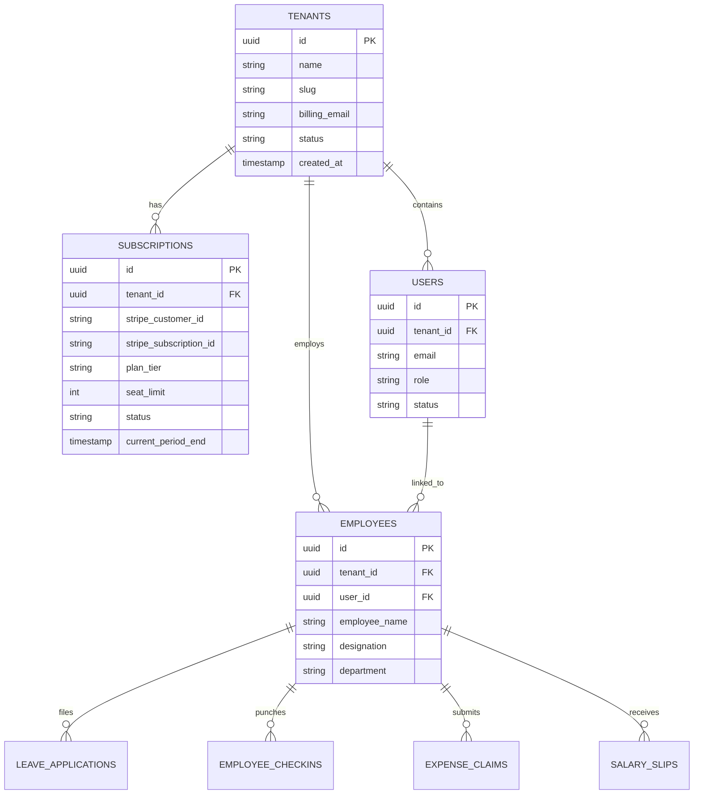
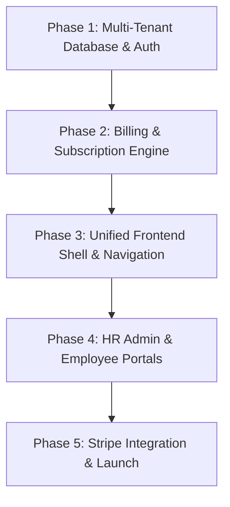

# HR SaaS Architecture & Frontend Redesign Blueprint

## 1. Executive Summary & Product Vision

This document details the transformation of the current single-instance HR code into a commercial, multi-tenant **B2B SaaS HR Platform**.

```
+---------------------------------------------------------------------------------+
|                                SaaS Platform                                    |
+---------------------------------------------------------------------------------+
                                      |
       +------------------------------+------------------------------+
       |                                                             |
+---------------+                                             +---------------+
|   Company A   | (Tenant: Acme Corp)                         |   Company B   | (Tenant: Globex)
|  - Pays monthly fee                                         |  - Pays monthly fee
|  - HR Admin: Alice                                          |  - HR Admin: Bob
+---------------+                                             +---------------+
       |                                                             |
  +----+----+----+                                              +----+----+
  |    |    |    |                                              |    |    |
[Emp1][Emp2][Emp3] (Invited Members)                          [Emp1][Emp2] (Invited Members)
```

### Core Business Paradigm
* **The Main Entity (Tenant / Subscriber)**: The **Company / Employer**, managed by the **HR Lead / Business Owner**.
  * The Company is the legal and billing entity.
  * The Company subscribes to a monthly plan (e.g., base fee + per-employee pricing).
* **The Mini Entities (Sub-Users / Members)**: The **Employees**.
  * Employees do not pay anything.
  * Employees receive invitations to access self-service portals (attendance, leaves, payslips, roster).
  * Their accounts exist strictly under their company’s tenant workspace.

---

## 2. Multi-Tenancy & Entity Relationship Model

To convert the database into a secure SaaS system on **Neon PostgreSQL**, every functional table will be partitioned by `tenant_id` (or `company_id`).



### Role-Based Access Control (RBAC)

| Role | Entity Level | Capabilities |
| :--- | :--- | :--- |
| **Super Admin** | Platform-wide | Manages platform health, tenant billing, system-wide analytics |
| **Company Owner / HR Admin** | Tenant-level | Manages billing/plan, invites/offboards employees, sets company policies, approves leaves & payroll |
| **Department Manager** | Team-level | Approves shift requests, reviews team attendance, signs off on department expenses |
| **Employee** | Self-Service | Clock in/out, view assigned shifts, submit leave requests, download payslips |

---

## 3. SaaS Subscription & Billing Model

### Pricing Strategy
1. **Starter Plan**: \$29/month (up to 15 employees).
2. **Growth Plan**: \$79/month (up to 50 employees) + Advanced Attendance & Geolocation.
3. **Enterprise Plan**: \$199/month (Unlimited seats) + Custom Payroll & Shift Scheduling.

### Billing Lifecycle
1. **Company Sign-up**: HR Lead registers with Company Name, Work Email, and Password.
2. **14-Day Free Trial**: Automatically provisions workspace with full features.
3. **Stripe / LemonSqueezy Integration**: Customer portal for updating payment method, downloading invoices, and changing seat counts.
4. **Automated Seat Enforcement**: If the HR Admin tries to invite an employee beyond their paid tier, the system prompts them to upgrade seats before sending the invite.

---

## 4. Frontend Redesign: From Fragmented to Unified SaaS

Currently, the codebase has two separate interfaces:
- `hrms/frontend`: Narrow 384px mobile PWA.
- `hrms/roster`: Isolated desktop calendar.

### The New Architecture: One Responsive Modern Platform
We will consolidate into a single, cohesive **Vue 3 + Tailwind CSS + Pinia** platform that adapts seamlessly across mobile and desktop.

```
+----------------------------------------------------------------------------------+
| Top Navigation: [Company Logo]  Acme Corp (Pro Plan)      [Notifications] [User] |
+----------------------------------------------------------------------------------+
| Sidebar (Desktop) | Main Workspace                                               |
|                   |                                                              |
| [Dashboard]       |  +-------------------+  +-----------------+  +-------------+ |
| [Team Directory]  |  | Total Employees   |  | Active Leaves   |  | Today Clocks| |
| [Attendance]      |  | 24 / 50 seats     |  | 3 Approved      |  | 21 ClockedIn| |
| [Leaves]          |  +-------------------+  +-----------------+  +-------------+ |
| [Roster Schedule] |                                                              |
| [Payroll]         |  [Live Attendance Feed]        [Pending Approvals]           |
| [Billing & Plan]  |  - John Doe (Clocked In 9:02)  - Sarah: Annual Leave (2d)    |
| [Settings]        |  - Jane Smith (Remote 8:55)    - Mike: Travel Expense ($45)  |
+-------------------+--------------------------------------------------------------+
```

### Key UI Features

#### For the Company HR / Lead:
* **Billing & Seats Hub**: Visual seat meter ("24 of 50 active seats used"), invoice downloads, plan switcher.
* **Employee Management**: 1-click invite link generation, department assignments, quick onboarding checklist.
* **Company Controls**: Custom leave policies, working hours, and holiday calendar configuration.
* **Unified Approval Inbox**: Approve/reject leaves, shift swaps, and expense reimbursements in one place.

#### For the Employee:
* **Responsive Self-Service**:
  * On Desktop: Wide dashboard card with one-click clock-in, remaining leave balances, and month calendar.
  * On Mobile: Touch-optimized action bar with big Clock In/Out button and native-feeling tabs.
* **No Billing Visibility**: Clean workspace without plan/pricing clutter.

---

## 5. Implementation Roadmap



### Phase 1: Database Multi-Tenancy (Neon PostgreSQL)
- [ ] Add `tenants` and `subscriptions` tables.
- [ ] Add `tenant_id` to all relational tables (`employees`, `checkins`, `leaves`, `payroll`).
- [ ] Add tenant-aware session tokens.

### Phase 2: Billing & Plan Logic
- [ ] Implement plan tiers and seat limits in the backend.
- [ ] Stripe webhooks for subscription creation, upgrades, and cancellations.

### Phase 3: Frontend Consolidation & Redesign
- [ ] Unify layout into a responsive dashboard shell (collapsible desktop sidebar + mobile drawer).
- [ ] Modern UI design system (Tailwind CSS, clean typography, badge indicators, subtle shadows).
- [ ] Dynamic workspace switcher (HR Admin view vs Employee view).

### Phase 4: Core Workspaces
- [ ] **Onboarding & Company Creation Flow**: Sign up company -> enter company name -> pick plan -> invite team.
- [ ] **Billing Management Screen**: Live seat counter, upgrade/downgrade buttons, invoice history.
- [ ] **Interactive Roster & Attendance Dashboard**: Fully integrated directly into the main portal.
